# 磁力方块探险家 / Magnet Island

Rust + Bevy 制作的离线小游戏合集，以立体磁力方块编程世界为主线，包含益智、动作与休闲玩法。先面向安卓，提供 macOS 桌面调试版。不是网页或 WebView 应用。

## 游戏画面一览

以下直接使用项目已有的实机截图。点击图片可查看大图；每张图下方是对应的画面与玩法介绍。

| 游戏 | 游戏 |
| --- | --- |
| **磁力小岛**<br><a href="docs/screenshots/island.jpg">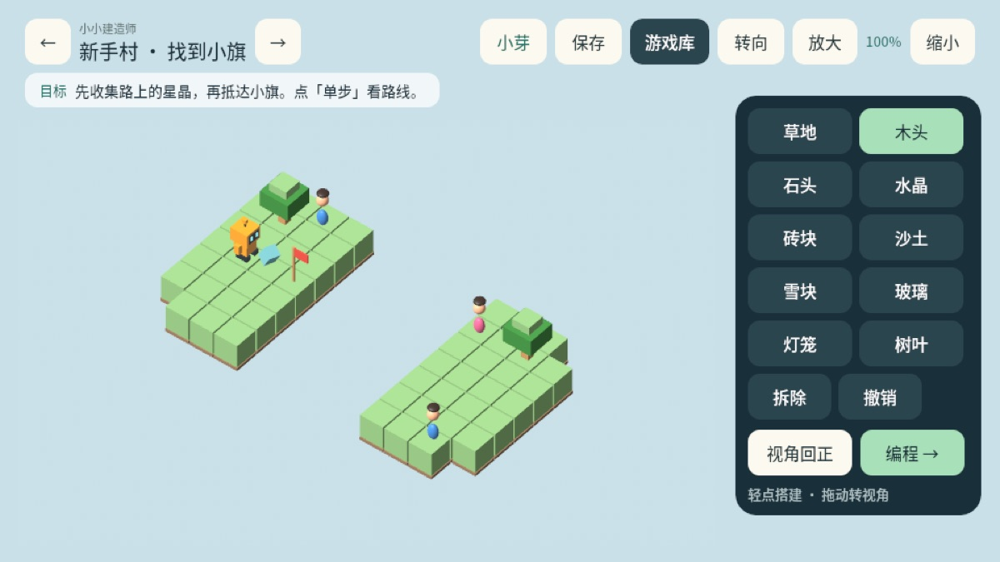</a><br>在立体方块小岛上搭桥、放置材料，再编排指令让机器人抵达目标。 | **2048 球球**<br><a href="docs/screenshots/ball2048.jpg">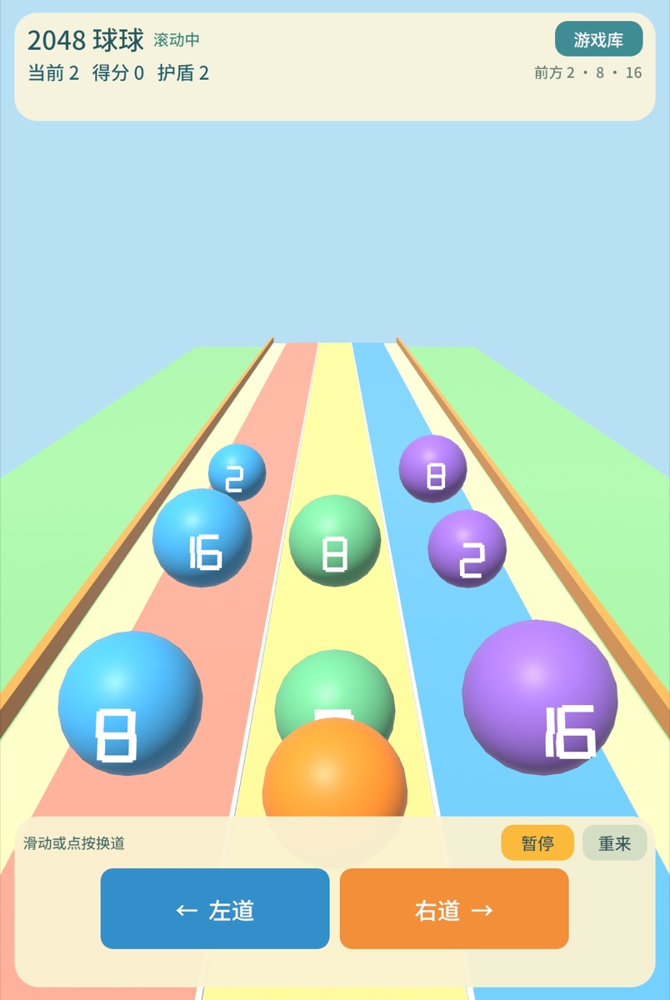</a><br>在三条彩色跑道之间换道，让相同数字的球相撞合并。 |
| **方块消消乐**<br><a href="docs/screenshots/tetris.jpg">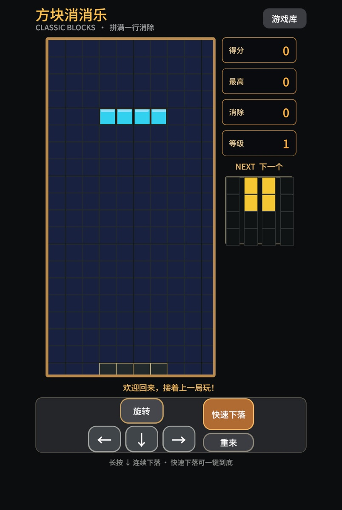</a><br>在竖屏棋盘中移动、旋转下落方块，拼满一行即可消除。 | **数学游乐岛**<br><a href="docs/screenshots/math.jpg">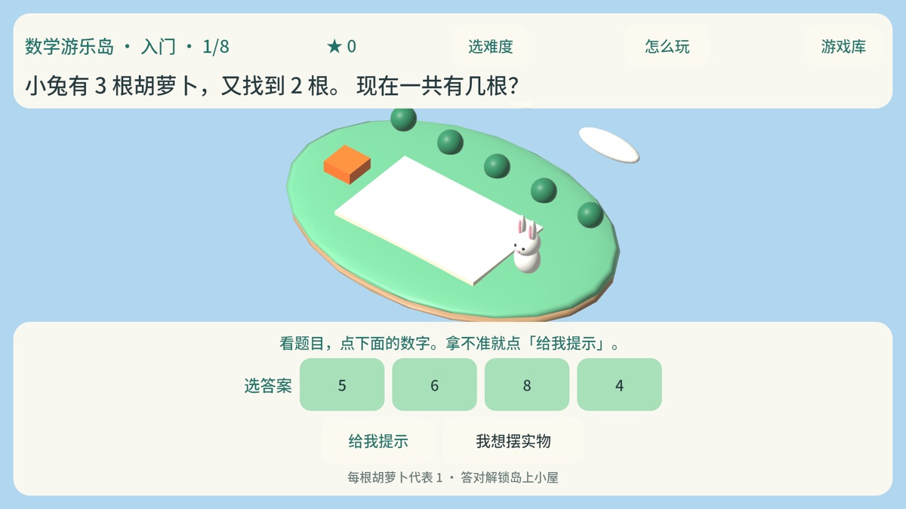</a><br>根据岛上的情景题选择答案，也能展开实物帮助数数。 |
| **识字小岛**<br><a href="docs/screenshots/literacy.jpg">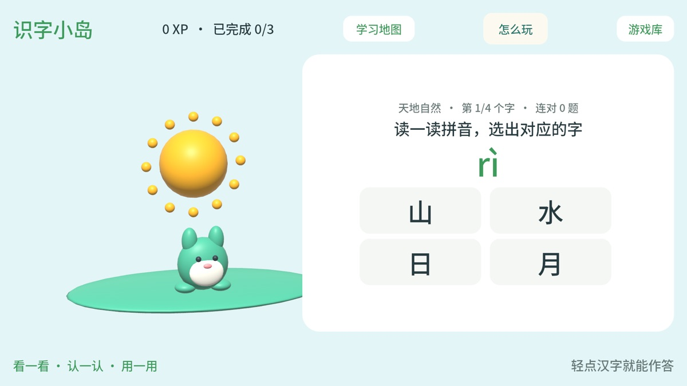</a><br>看图认字、组词闯关，答题后会得到即时提示。 | **小小消防队**<br><a href="docs/screenshots/fire.jpg">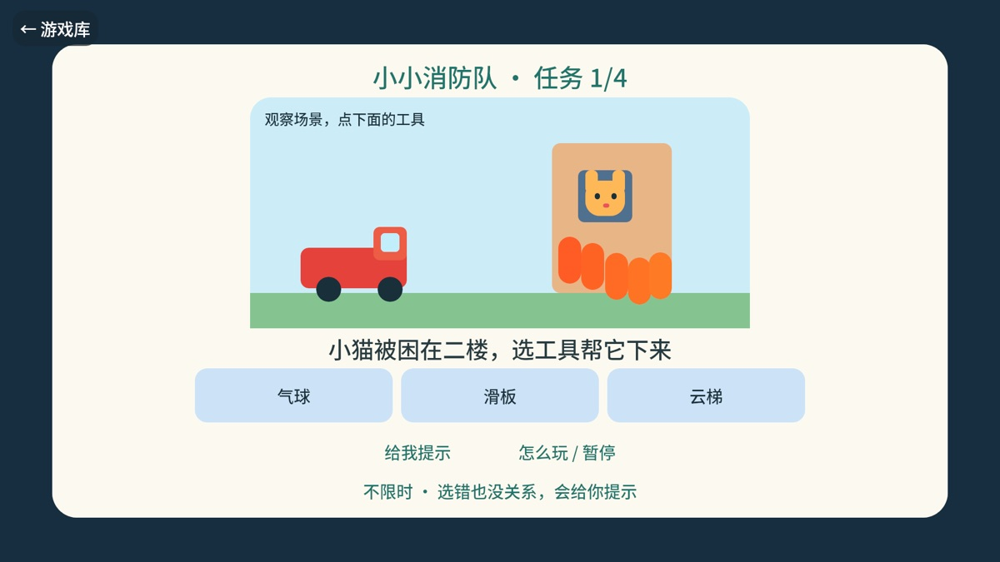</a><br>在消防场景里判断情况，选择救援工具完成任务。 |
| **神秘博物馆侦探**<br><a href="docs/screenshots/detective.jpg">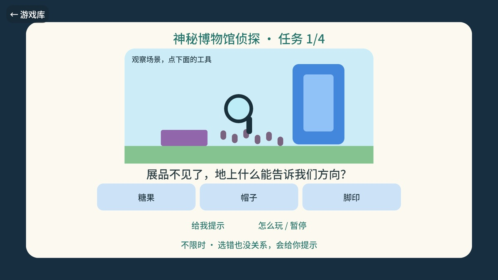</a><br>跟随线索与脚印，在博物馆里逐步找回展品。 | **太空种植园**<br><a href="docs/screenshots/farm.jpg">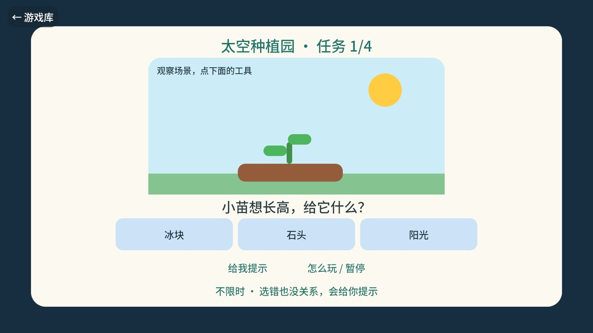</a><br>调整光照、水分和温度，让星球植物成长。 |
| **彩虹钢琴派对**<br><a href="docs/screenshots/piano.jpg">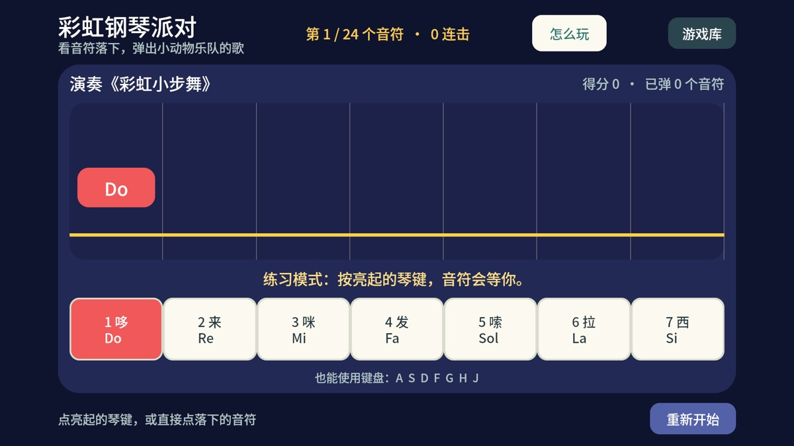</a><br>看着彩色音符落到琴键，跟着节奏弹奏。 | **迷你坦克大战**<br><a href="docs/screenshots/tank.jpg">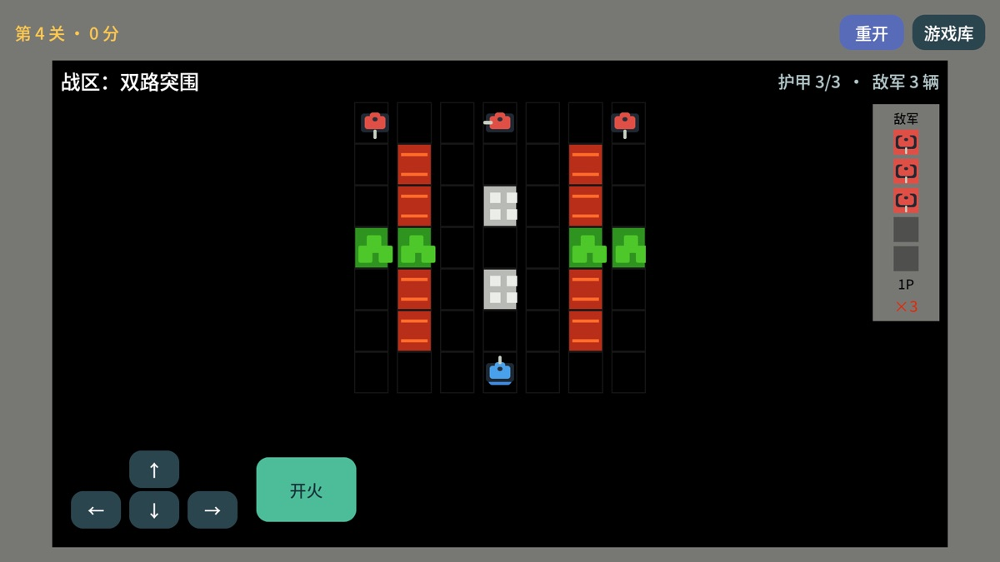</a><br>在砖墙迷宫中移动、躲避炮弹并守住基地。 |
| **彩虹泡泡岛**<br><a href="docs/screenshots/bubble.jpg">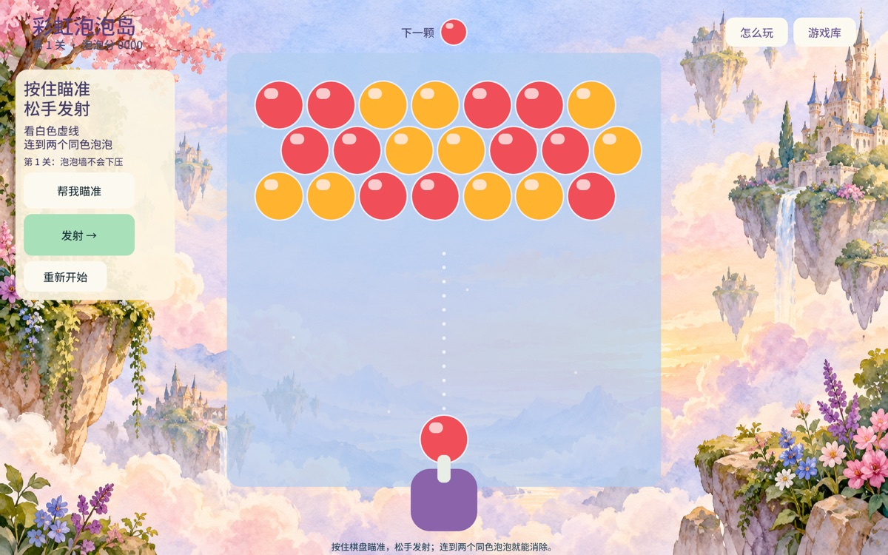</a><br>沿着瞄准线发射泡泡，连接同色泡泡将它们消除。 | **泡泡爆破王**<br><a href="docs/screenshots/bomber.jpg">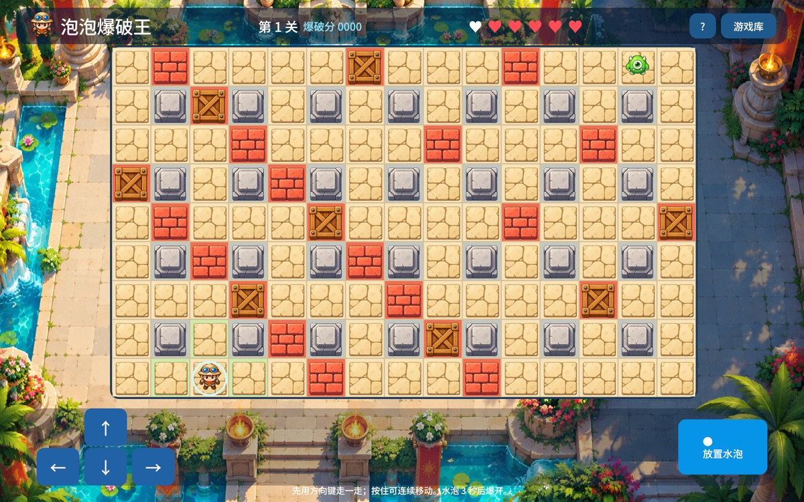</a><br>在方格迷宫中放下水泡，避开水柱并追击怪物。 |
| **水果忍者派对**<br><a href="docs/screenshots/fruit.jpg">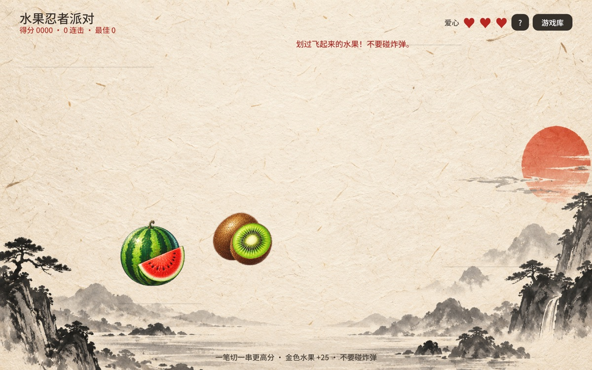</a><br>划开飞起的水果获取分数，小心混在其中的炸弹。 | **口袋大富翁**<br><a href="docs/screenshots/fortune.jpg">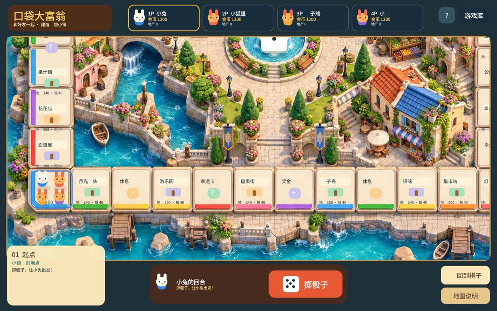</a><br>沿着彩色小镇棋盘掷骰前进，购买地块并建起房屋。 |
| **水果转转乐**<br><a href="docs/screenshots/slots.jpg">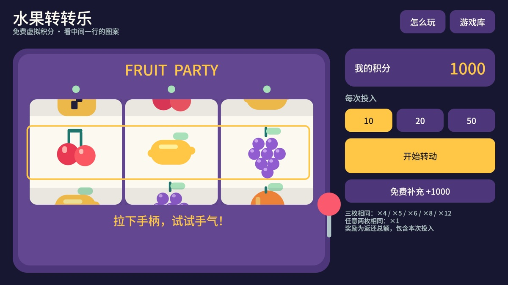</a><br>转动三列水果图案，按中间一行结算免费虚拟积分。 | **经典水果机**<br><a href="docs/screenshots/arcade.jpg">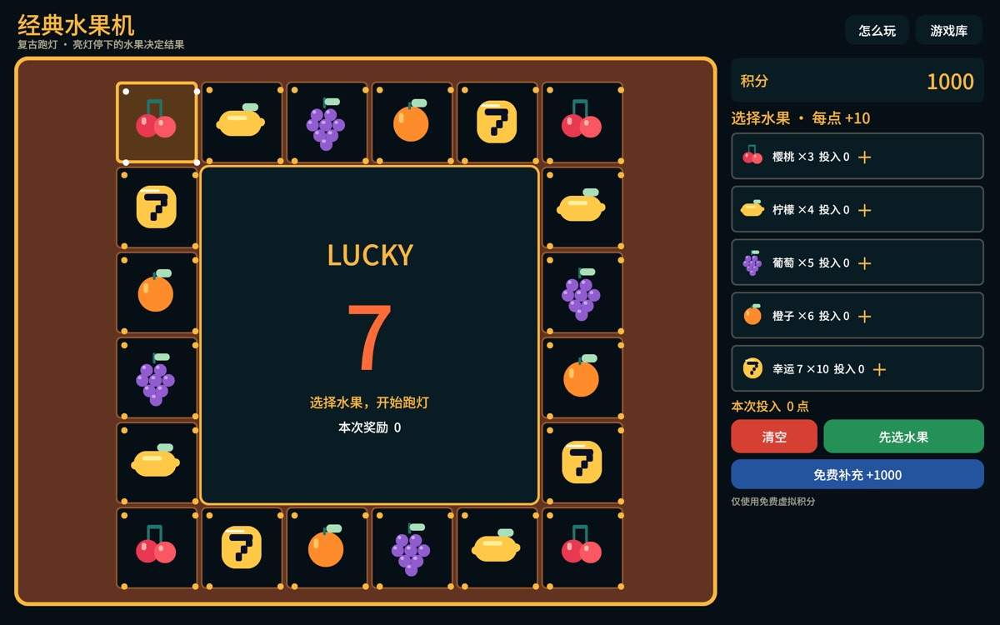</a><br>在复古机柜上选择水果，看环形跑灯停在哪一格。 |
| **捕鱼达人**<br><a href="docs/screenshots/fishing.jpg">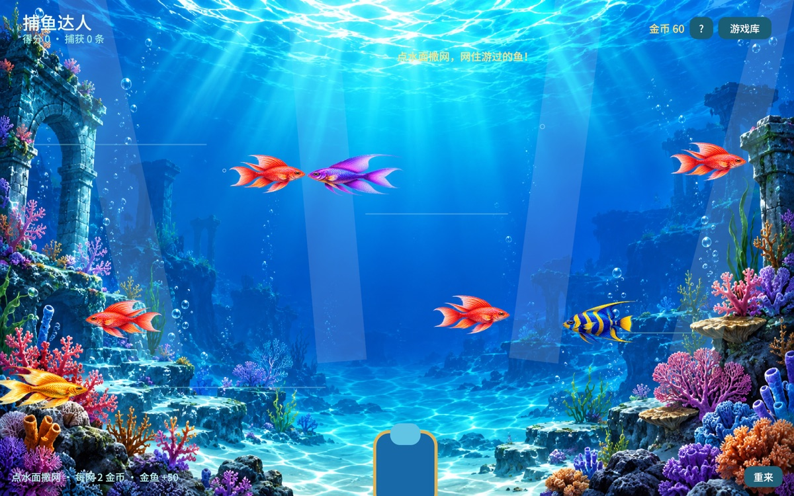</a><br>向游动的鱼群撒网，捕获不同鱼种获得金币。 | **小熊寻蜜**<br><a href="docs/screenshots/honey.jpg"></a><br>等摇摆抓钩对准蜂蜜罐，再放下抓钩把蜂蜜带回小熊身边。 |

游戏库还有这些入口；目前项目中没有它们的现成实机截图：

- **云桥工程师**：在云海间放置方块，用指令引导机器人过桥。
- **小小动物餐厅**：在方块世界里布置餐桌、厨房和食材区。
- **自由搭建工坊**：使用十种磁力方块自由搭建，作品保存在本机档案。
- **像素突击队**：横版奔跑、跳跃和射击，抵挡机械小怪。
- **蘑菇跳跳岛**：踩小怪、收金币，跑到终点旗帜。
- **星际飞行队**：驾驶战机左右移动，射击敌机并躲开陨石。
- **中秋博饼会**：摇六颗骰子，收集本局的中秋福礼。
- **贪吃蛇**：控制小蛇吃果实，避开边界和自己的身体。
- **扫雷**：翻开安全格，并用旗帜标记可疑的地雷。
- **经典 2048**：滑动数字方块，合并成更大的数字。
- **华容道**：移动棋子，为曹操打开通往出口的路。
- **推箱子**：把箱子逐个推到发光的目标格。
- **数独乐园**：选择 4×4 或 9×9 棋盘，按行、列和宫格填数。
- **霓虹打砖块**：移动挡板反弹小球，打碎砖块并接住道具。
- **元素小实验室**：在元素周期表上选择元素，完成配方拼图。
- **光路小侦探**：旋转镜片，让光束反射到水晶。
- **花园守卫**：收集阳光、种下植物，守住五条花园战线。

## 这一版可以做什么

- 游戏库入口：磁力小岛、云桥工程师、小小动物餐厅、自由搭建工坊，以及独立的 2048 球球游戏。
- 2048 球球游戏从 2 开始自动向前滚动，左右换道；撞到相同数字会合并翻倍，撞到陷阱会失败。
- 草地、木头、石头、水晶四种方块；点击放置、拆除、撤销，网格吸附。
- 左右拖动旋转、上下拖动调整俯仰视角、滚轮/双指缩放，也有明确的旋转和缩放按钮。
- 点击添加和删除指令：放木块、前进、左转、右转。最多 8 张指令卡片。
- 循环次数 1–8，可选择循环后再前进一步；运行、暂停、单步、复位。
- 出错即停止并显示原因，高亮当前指令；复位恢复运行前的世界。
- 五个引导关卡、一个带创作目标的家园场景，以及独立的自由搭建工坊。
- 自由搭建工坊没有机器人、终点或任务目标；十种磁力方块可任意组合，17×11 格画布最高可搭 13 层，作品按本机档案自动保存。
- 小芽、小树两个独立本机档案。每个档案保留当前场景、程序和完成记录。
- 编辑后自动保存，也可以点击保存。无需账号、网络或后台。

## 小游戏操作与动画更新

本轮进一步简化操作：数学默认只显示直接答题，摆实物工具按需展开；识字选错后可直接改选；三个故事游戏增加提示；钢琴音符与琴键对齐，也可直接点音符；泡泡提供“帮我瞄准”和独立发射按钮；爆破支持点击相邻亮格移动。这八款游戏都增加了“怎么玩”和暂停帮助页。

- 2048 球球：进入游戏会切到竖屏；可在赛道中部左右滑动，也可使用底部两个大按钮换道，桌面端支持 A / D 或左右方向键。
- 方块消消乐：竖屏俄罗斯方块玩法；下一个方块预览、消行计分、等级加速和快速下落都提供大号按键。棋盘、当前得分与最高分自动保存在本机，下次进入继续上一局；点“重来”才清空棋盘，最高分保留。
- 贪吃蛇：果园街机版，蛇身平滑跟随转弯，红果加分、每四颗出现一枚三分金果；移动会随得分加快，撞墙或撞到身体后可以重新开局。支持屏幕方向键、WASD、空格暂停和触屏方向盘。
- 蘑菇跳跳岛：原创横版跑跳关卡。左右调整站位、跳过砖块、踩掉小怪并收集金币，抵达 300 米处的终点旗帜；手机提供大号左右键与跳跃键，桌面端支持 A / D、方向键、W 或空格。
- 方向控制统一：坦克、泡泡爆破等四向移动游戏使用同样的十字方向键；横版跑跳和飞行游戏使用相同样式的大号左右键与动作键，不再依赖拖动小摇杆或点屏幕边缘。
- 全部小游戏：点击操作会有轻提示音；开始、得分、切水果与危险/失败会使用不同的短音效。音效在运行时生成，无需联网或额外下载素材。
- 捕鱼达人：点击水面发射渔网，网住附近鱼群获得分数和金币；金鱼奖励最高，等待鱼群靠近后一次撒网更划算。
- 中秋博饼会：竖屏摇骰子小游戏，五次免费机会可收集桂花签、月兔灯和团圆章；所有福礼仅为本局离线趣味收藏，不含兑换、现实奖品或付费内容。可用 `MAGNET_START_GAME=moon` 预览。

- 数学游乐岛：可直接点数字作答，也可摆实物；实物落入托盘、答对时小兔跳舞并飘彩纸。选错会显示提示，完成一轮保持当前难度。
- 识字小岛：点汉字立即检查；图形浮动、小芽跳舞和彩纸反馈；保留不计时和错题复习。
- 小小消防队、神秘博物馆侦探、太空种植园：每道题使用对应的选项，四步任务配有消防车与水流、放大镜与脚印、浇水与植物生长场景。选错给提示，完成后自己点下一步。
- 彩虹钢琴派对：练习模式的音符慢慢下落并等待，不因超时跳过；目标琴键亮起，按键有颜色反馈。
- 彩虹泡泡岛：方形棋盘统一显示和碰撞比例，按住看真实轨迹、松手发射；消除有散开碎粒。首关两种颜色且不会下压，后续连续八次未消除才下压，普通弹药选自场上颜色。
- 泡泡爆破王：按住方向可连续走，角色平滑移动；水泡倒数三秒、危险格闪烁、水花扩散；五条命和复活护盾，准备好移动后敌人才开始行动。

动画截图预览可使用 `MAGNET_START_GAME=math|literacy|fire|detective|farm|piano|bubble|bomber` 配合下方的截图命令。`MAGNET_CAPTURE_MOTION=1` 会额外保存第 30 帧，`MAGNET_PREVIEW_SUCCESS=1` 可检查学习游戏的完成场景，`MAGNET_PREVIEW_HELP=1` 可检查暂停帮助页；预览时请指定独立的 `MAGNET_SAVE_DIR`。

自由搭建工坊可从游戏库的“自由搭建工坊”进入；开发预览也可使用 `MAGNET_START_GAME=freebuild`。

## 霓虹打砖块

游戏库中的三关横屏街机小游戏。拖动挡板接球，击碎彩色砖块；连续命中会提高分数。每打掉六块砖会掉落一种道具：加宽挡板、多球或自动激光。后两关有移动砖墙和多次命中才会打碎的核心。初始三条命，通关后显示总分。

Mac 版可用鼠标拖动，或按 A / D、左右方向键移动；点击棋盘或按空格发球，P 暂停，R 重来。手机用手指在棋盘内拖动即可。可用 `MAGNET_START_GAME=breakout` 直接进入游戏。

## 花园守卫

横屏五路花园防守小游戏，使用绘制的草地场景、植物和怪物素材。选择植物卡片后点草地种植，点击落下的阳光补充能量。向日葵生产阳光，豌豆射手攻击同路怪物，坚果拖住敌人，冰花减速，辣椒一次清理一条战线。先布置花园，再点“开始守卫”；共有三关，清空本关所有波次后可继续下一关。每条战线还有一次救场推车。第一关适合入门，后两关增加铁桶和巨兽，需要添置第二排射手或冰霜花。

Mac 版支持鼠标；数字 1–5 选择植物，空格开始或暂停，P 暂停，R 重来，S 切换铲子，Esc 退出铲子。手机可直接点卡片、草地和阳光。返回游戏库后重新进入会开新局，当前对局不保存到磁盘。可用 `MAGNET_START_GAME=garden` 直接进入；仅在截图预览中设置 `MAGNET_CAPTURE_GARDEN_DEMO=1` 才会填入中途战斗场景。

美术与提示词保存在 `assets/garden/ART_NOTES.md`：背景、四帧植物、四帧怪物和阳光/推车/子弹使用内置图像生成工具绘制。运行时按真实角色边界裁切、脚底对齐，结合呼吸后坐、行走啃咬、冰冻、命中碎粒、整行火焰和阳光飞入计数器的动画。不是静态效果图。

## 元素小实验室

游戏库中的横屏元素周期表小游戏。前 40 号元素按真实周期与族的位置排成卡片，点卡片收集每关需要的元素，完成水、氧气、二氧化碳、食盐、石英、碳酸钙、小苏打、氧化铁、氧化铜、氧化锌和氧化锆共 11 个配方挑战。前两关用亮边引导，后面的关卡在选错时才短暂提示。点过的元素会在中间放大显示中文名、符号和原子序数；每关有得分与完成动画。关卡进度自动保存在本机，旧版 7 关进度会自动衔接新增关卡。它只是屏幕上的配方拼图，不表示可以在现实中混合元素。

开发预览：`MAGNET_START_GAME=elements`。元素信息参考 [IUPAC 周期表](https://iupac.org/what-we-do/periodic-table-of-elements/)，配方参考 [PubChem](https://pubchem.ncbi.nlm.nih.gov/)。

## 数独乐园

游戏库中的竖屏数独小游戏。可选 4×4 入门和 9×9 经典；点格子再点数字填写，同行、同列和同一个小方宫会一起高亮，错误数字会显示红色。提供清除、提示、重来当前题和换一题。每道题都有确定解，换题会变换数字与棋盘排列；未完成的棋盘自动保存在本机，返回游戏库后也能接着玩。开发预览可使用 `MAGNET_START_GAME=sudoku`。

## 光路小侦探

游戏库中的竖屏镜面益智关卡。点击四块镜片切换斜面方向，光束会按镜面反射规律重新计算并沿实际路线逐段传播；碰到棋盘边缘会停止，只有抵达水晶才会触发点亮动画。可用 `MAGNET_START_GAME=lightpath` 直接预览。

## 坦克大战开火规则

敌军按独立节奏朝炮口方向开火，不再等玩家进入同一行或列才瞄准发射。开炮前变黄预警 0.9 秒并锁住朝向与位置；发射后冷却 2.8 秒。敌方炮弹速度低于玩家炮弹，受击后有 2.5 秒保护，出生与换关有 1.5 秒保护。

## 坦克大战关卡

共有 8 张地图，按顺序挑战：红砖峡谷、灌木通道、钢墙要塞、双路突围、十字街区、环城包抄、曲线走廊、星形堡垒。每关总计 10、12、14、14、16、16、18、20 辆敌军，同时在场上限分别为 2、3、3、3、4、4、4、4 辆。出现空位后每两秒补充一辆，出生点被占用或紧邻玩家时等待。全部敌军消灭后才过关，并补一格护甲（最多三格），第八关后循环地图。失败时可重试本关，补满护甲并保留得分。

使用 `MAGNET_START_GAME=tank MAGNET_TANK_MAP=3` 可预览第四关，地图编号为 0–7。

## 小镇地产赛（游戏库第 17 款）

20 格彩色小镇棋盘，地图尺寸超出屏幕，按住棋盘拖动可查看各处。视角自动跟随当前角色，手动拖动后可点“回到角色”恢复跟随，下次掷骰也会恢复。中心小镇银行会显示当前阶段：掷骰、沿街前进、到站决策、交易结算或终局排名。玩家小兔与电脑小狐狸轮流掷骰。骰子点数滚动、角色逐格跳跃、买地与升级时房子升起、金币沿弧线飞动，胜利时飘彩纸；动画播放时不会重复接受掷骰或购买。

双方各有 1200 金币，可买地、升级两次并收租。经过起点获得 200 金币，幸运卡、奖金站和公园产生奖励或费用。每人行动 12 次后按“金币 + 房产购置与升级价值”比较总资产；金币耗尽则提前结束。小狐狸自动行动，玩家只需掷骰以及选择购买或跳过。“怎么玩”打开时暂停。当前对局不保存到磁盘，重新进入游戏会开新局。

预览：`MAGNET_START_GAME=fortune`。仅在设置 `MAGNET_CAPTURE` 时，`MAGNET_FORTUNE_SCENE=choice|roll|build|finished|demo` 才启用样例房产与相应动画；`demo` 会自动演示双方操作。可用 `MAGNET_CAPTURE_SEQUENCE` 指定已存在的目录导出连续画面。

## 水果转转乐（游戏库第 18 款）

离线水果老虎机小游戏，使用免费虚拟积分，初始 1000 分。每次投入可选 10、20、50 分，积分可随时在空闲时免费补充。三列转轮连续滚动并依次减速停下，按中间一行结算：樱桃、柠檬、葡萄、橙子、7 三连分别返还投入的 4、5、6、8、12 倍，任意两枚相同返还 1 倍，其余不返还。返还包含本次投入。每列五种图案等概率独立抽取。

转动中不能重复启动、改变投入或补分；停完后只结算一次。中奖有灯光和积分粒子动画，打开说明会暂停。重新进入游戏从 1000 分开始，没有充值、提现或兑换功能。

预览使用 `MAGNET_START_GAME=slots`；仅设置 `MAGNET_CAPTURE` 时，`MAGNET_SLOTS_SCENE=spin|pair|win` 才会使用固定结果演示动画，普通游戏使用随机结果。

## 本机启动

本项目的 Rust 工具安装在 `.tools/`，不会修改全局 PATH。每次从项目根目录运行：

```sh
. ./scripts/env.sh
cargo run --locked --bin magnet-island
```

其他电脑可以使用自己的 Rust 工具链直接执行 `cargo run --locked`。首次构建需要联网获取依赖；运行时无需联网。

## 安卓打包

需要 Rust 的 `aarch64-linux-android` 目标、`cargo-apk`、Android SDK/NDK 和 JDK。当前配置使用 NDK 27.1，支持 ARM64，最低 Android 8.0（API 26）。实际 GPU 兼容性仍需真机验证。

```sh
. ./scripts/env.sh
rustup target add aarch64-linux-android
cargo install cargo-apk --locked
cargo apk build --lib
```

开发 APK 位于 `target/debug/apk/magnet-island.apk`。这是开发签名，供个人测试；正式发布需单独配置发布签名并妥善保管密钥。

```sh
adb install -r target/debug/apk/magnet-island.apk
```

`scripts/env.sh` 的 SDK/NDK/JDK 默认路径对应当前 Mac；其他机器可通过环境变量覆盖。iOS 尚未配置和验证，不应把安卓构建成功视为 iOS 已经适配完成。

## 手机界面预览（Mac）

```sh
. ./scripts/env.sh
MAGNET_PHONE_PREVIEW=1 cargo run --locked --bin magnet-island
```

小岛取景避开顶部提示和工具栏。搭建时右侧显示材料、拆除、撤销和视角回正；点击「编程」后显示指令与运行按钮。运行时收起编程面板，目标和操作结果显示在顶部。

轻点放置，拖动旋转；触摸允许少量手指抖动。工具栏会拦截点击，双指缩放和取消的触摸不会放置方块。视角不会转到地面下，迷失方向时可点「视角回正」。

## 怎么玩

1. 选择“小芽”进入顺序启蒙；“小树”默认从搭桥关开始。两个入口都能自由切换关卡。
2. 点“单步”，观察当前指令与机器人动作；点“运行”自动执行。
3. 点指令卡片删除，再从下面点选新指令；改程序会恢复运行前的场景。
4. 第四关：`重复 5 次 { 放木块；前进一步 }`，开启“循环后再前进”。第五关改为重复 3 次。
5. 切换到“搭建”，在水面放基础方块，点方块顶面向上堆叠、点侧面横向连接，可以搭出中间留空的桥梁和屋顶。小岛边界为 15×9 格，最高 5 层。
6. 复位只撤销程序的运行结果，搭建的撤销使用“撤销”按钮。

切换关卡会开始该关的新场景；当前原型还不是多作品收藏架。请保留重要作品的存档备份。

## 存档与素材

- 桌面：`saves/island-v1.json`。可用 `MAGNET_SAVE_DIR` 指定其他目录。
- 安卓：应用私有数据目录。卸载应用会删除这些数据。
- 存档是带版本的 JSON，写入临时文件后替换正式文件，并校验读取内容。
- 尚未提供手机端导出/导入、云同步、语音提示、拖拽排序、嵌套循环或条件指令。
- 当前场景使用柔和纯色材质；项目保留的像素纹理由 `scripts/generate_textures.py` 原创生成，字体使用 Noto Sans SC，授权见 `assets/fonts/OFL.txt`。

## 验证

```sh
. ./scripts/env.sh
cargo test --locked --lib
cargo check --locked
```

规则测试覆盖搭桥循环到达目标、失败时状态不变、前三关解法、独立档案与存档校验、放置保护、执行上限和射线选块。

可生成实际引擎画面（需要可用的图形桌面）：

```sh
mkdir -p output
MAGNET_CAPTURE=output/preview.png MAGNET_SAVE_DIR=/tmp/magnet-preview cargo run --locked --bin magnet-island
```

渲染 90 帧后保存截图，150 帧后退出。此变量仅用于开发验收，不用于正常游戏。

## 代码结构

- `src/game.rs`：与引擎无关的世界、指令、关卡、执行器和存档数据。
- `src/app.rs`：Bevy 场景、手机输入、界面、动画和本地持久化。
- `src/play_ui.rs`：任务题目、儿童动画场景、实物落下和彩纸反馈。
- `src/lib.rs`：共用启动入口与安卓 NativeActivity 入口。
- `build.rs`：安卓原生库 16 KiB 页面对齐参数。

当前是验证玩法和技术路径的原型。画面使用简单模型和实时光照，尚未达到概念图中的美术精细度。

## 经典水果机（游戏库第 19 款）

参考老式水果街机的红色机柜、数码计分牌和 20 格环形跑灯。点击水果每次增加 10 点，可同时选择多种；启动后扣除本次总投入，亮灯绕圈并逐渐减速，停稳后按所中水果投入 × 倍率结算。樱桃、柠檬、葡萄、橙子、幸运 7 的倍率依次为 3、4、5、6、10；每种图案各占 4 格，20 格等概率。奖励含投入，未选中的图案不返还积分。保留选择方便再次启动，也可清空重新分配。转动中不能更改投入或重复启动。

仅使用可免费补充的虚拟积分，无充值、提现或兑换。退出后重新进入会重置。开发预览可使用 `MAGNET_START_GAME=arcade`；`MAGNET_ARCADE_DEMO=1` 仅在截图模式下触发固定演示结果。

屏幕方向按当前游戏切换：飞机大战（SkyRaid）、2048 球球、方块消消乐、数独和光路小侦探竖屏，游戏库和其他游戏使用横屏。返回游戏库立即请求恢复横屏。安卓通过 Activity 的方向请求切换，旋转配置变化由现有 Activity 处理，保留游戏状态。

坦克大战触屏控制：左侧 180 点圆形摇杆支持按住连续移动、滑动换向和松手停止，中心死区防止轻微抖动误走；右侧独立大开火键支持按住连发、双指边走边打。移动触点绑定手指 ID，不受界面重建或另一根手指影响。

## 开源协议

项目代码与原创素材采用 [MIT License](LICENSE)。随项目提供的 Noto Sans SC 字体遵循 [SIL Open Font License 1.1](assets/fonts/OFL.txt)。
