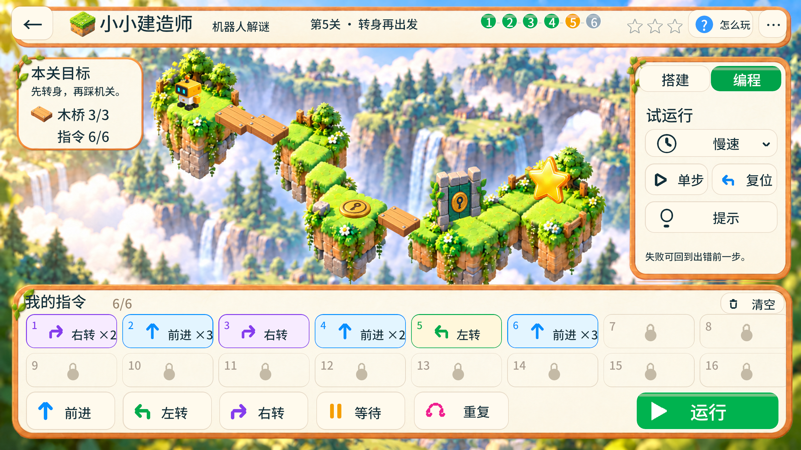

# 搭建解谜 · 新增六关

2026-10-29。用户要求“再加几关”，两款各新增3关，从各3个代表关扩展为各6关。沿用已确认的场景、界面、桥块、风口、机关与行动卡，不引入新美术风格或移动平台等新机制。

状态：214项规则测试通过；两款全部12关、六个新增关卡宽屏操作及旧档扩展实测通过。

## 新增关卡

| 游戏 | 编号／名称 | 规则与一条合法解 |
|---|---|---|
| 云桥工程师 | 3 精打细算 | 木桥2、石桥1；普通缺口也能用石桥，三格近路需要混合用材 |
| 云桥工程师 | 5 风口取舍 | 近路两处风口、库存却只有石桥1；改走绕路，用木桥6、石桥1接通并取星 |
| 云桥工程师 | 6 逆风返航 | 从右岸回到左岸；取星绕路的风口必须留石桥，其余6个绕路缺口用木桥 |
| 小小建造师 | 2 两张卡过桥 | 木桥2，指令上限2张；用前进×3，或前进×2加前进到达小岛 |
| 小小建造师 | 4 七卡取星 | 木桥4、指令上限7张；星晶改为本关必需目标，走支路收集后才能过关 |
| 小小建造师 | 5 转身再出发 | 初始朝左、指令上限6张；先用左转×2或右转×2转身，再踩机关开门到达终点 |

云桥原1、2、4关与建造师原1、3、6关的规则保留。上方原有6个关卡圆钮现在全部可进入；上一关／下一关按显示编号1–6切换。

## 行为与存档

- 行动卡计数与锁定槽位按照本关2、6、7、8张的容量显示；超过上限时保留原程序并提示当前上限。
- 必取星晶关在终点前检查条件；没拿星晶时停止在前一格，不能提前获得通关和星级。
- 转身关的复位会恢复初始朝左；机器人按当前左右方向显示，云桥返航也会朝行走方向显示。
- 新关卡分别有合法三星解。风口失败、指令容量限制、退款和复位仍使用原有规则。
- 存档中原三个内部关卡位置保留，新关追加在后面；关卡编号不因数组扩展而改变。
- 三关存档可以直接读取，原星级、程序、搭建与当前关保留，新关进度初始化为空。首次保存扩展前复制原文件为 `*.before-expansion-<时间>.json`；备份失败改写恢复文件，保留原文件。
- 旧的 `island-v1.json`、`cloudbridge-v1.json` 不参与这次扩展，继续保留。

## 验证记录

`source scripts/env.sh && cargo test --locked --offline --all-targets`：214项通过，0失败。新增7项检查覆盖六个编号、三个新云桥解、两张卡限制、必取星晶门槛、转身／复位、三关存档扩展及新容量的存档校验。

实际运行：16:9两款各23项检查通过，全部12关通关，并复查分支关第二条路线；20:9两款各13项检查通过，覆盖全部六个新增关卡。逻辑窗口1280×720、1080×486，Retina截图2560×1440、2160×972。

旧档扩展：两款分别用三关旧存档连续重新启动两次，扩展为六关后原三关计划、星级与当前关保持；新增三关为空，扩展前备份与原文件逐字节一致，第二次启动不重复备份。`island-v1.json`、`cloudbridge-v1.json` 前后逐字节一致。

新增关卡的实际运行画面：

`output/building-puzzle-extra-levels-2026-10-29/` 保存本次日志和实际截图：

- `campaign-16x9/`：两款全部12关的实际搭桥／编程、通关与分支解法。
- `added-20x9/`：六个新增关卡的宽屏操作与截图。
- `compatibility/`：三关旧档的原文件、扩展备份、重启读取与逐字节检查。
- `tests.log`、`build.log`：规则测试与编译记录。

内部追加位置与截图对应：`added-a-*` 为云桥3／建造师2，`added-b-*` 为云桥5／建造师4，`added-c-*` 为云桥6／建造师5。

本次不制作APK，不改发布版本，不提交或推送Git；尚未在安卓真机验证。
