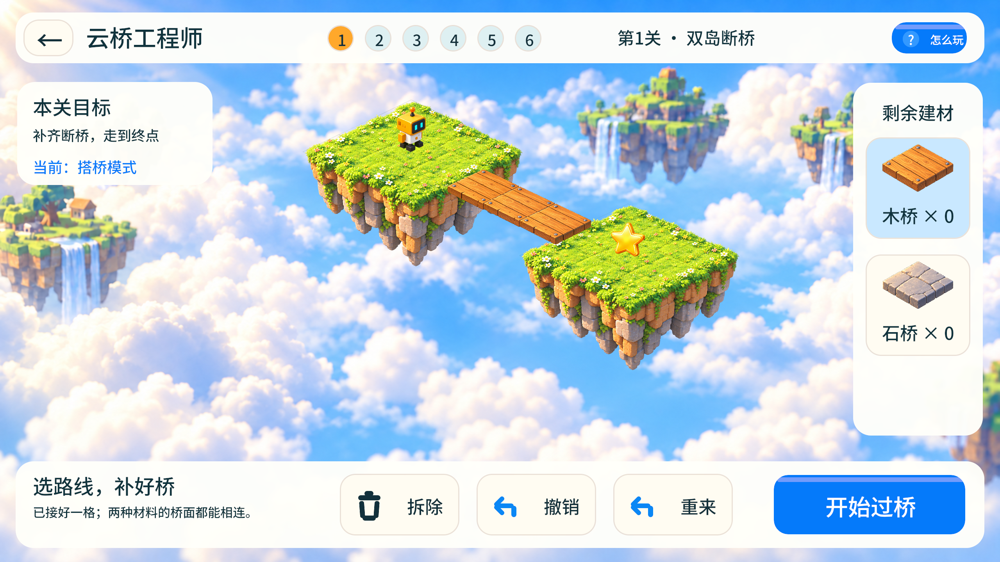
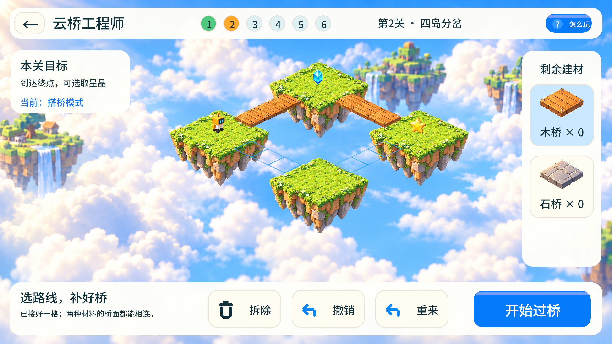
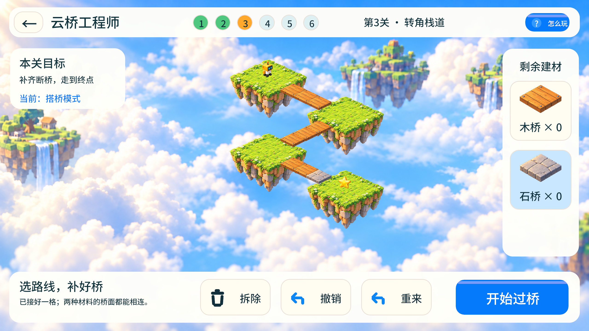
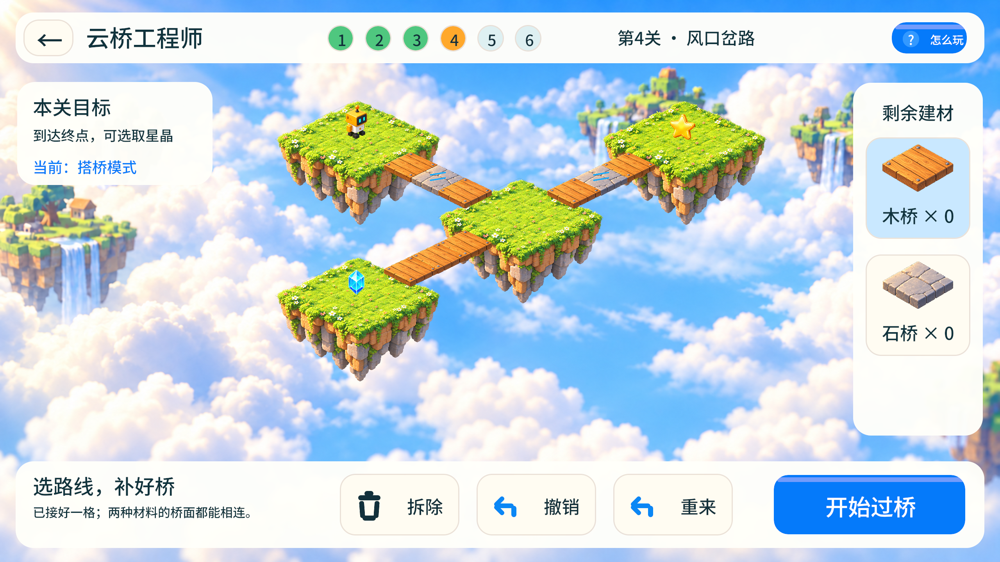
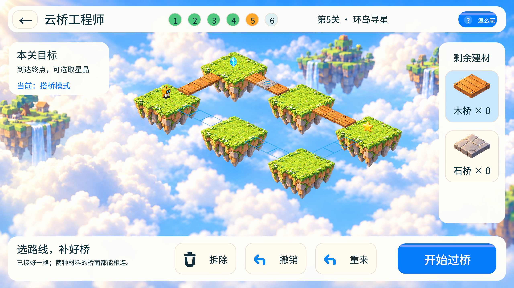
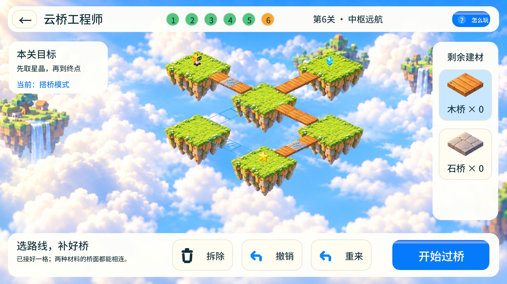
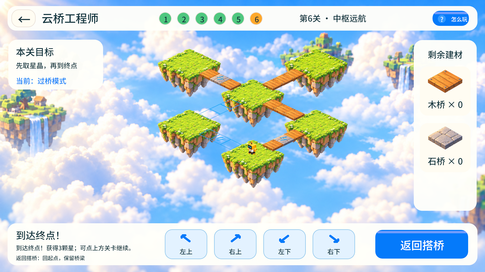

# 云桥工程师：六张独立地图与手动过桥验证

2026-10-29。用户确认[布局与操作稿](../designs/cloudbridge-map-variety-v3/README.md)并回复“做”后实施。已接入桌面源码；本次未打包APK。

## 最终行为

| 关卡 | 地图结构 | 材料／关键条件 |
|---|---|---|
| 1 双岛断桥 | 两岛直线 | 3木，学习搭桥与手动行走 |
| 2 四岛分岔 | 四岛回路 | 6木，只够铺一条支路；星晶可选 |
| 3 转角栈道 | 四岛折线 | 8木1石，连续转角 |
| 4 风口岔路 | T形岔路 | 7木2石，两处风口；侧岛星晶可选 |
| 5 环岛寻星 | 六岛环线 | 8木1石，两条路线；星晶路线带风口 |
| 6 中枢远航 | 六岛、中枢加回环 | 10木2石，先取星晶，再选择终点支路 |

搭桥时选材料、点蓝色缺口，拆除／撤销退回材料。开始过桥后，四个斜向按钮或WASD／方向键控制相邻格移动，长按可连续移动，松开停止。没有自动寻路行走。缺桥、木桥风口和岛外区域阻止通行。返回搭桥回到起点并保留桥梁，切换关卡保留各关的搭建和星级。

新进度写入 `cloud-walk-v3.json`；旧 `cloud-puzzle-v2.json`、`cloudbridge-v1.json` 不作为新地图通关记录，也不被覆盖。小小建造师继续使用原有指令与机关玩法。

## 与确认稿对照

- 地图JSON与确认稿逐字节相同。每岛3×3地表，相邻岛中心距离6格，中间3格桥；六张地图使用各自的岛屿坐标与连接关系。
- 地表、低矮木／石桥、风口、机器人脚底、点击命中使用同一投影与网格。桥面接入岸边，不再使用独立屏幕路径点。
- 主场景按确认稿同样的中心区域、边距和等距投影摆放；检查时修正了初版整体偏低的位置。宽屏整屏共用一层云海，避免中央画布与两侧补景重复、接缝。
- 顶部六关、左目标卡、右材料栏、底部操作栏和四个斜向控制与操作稿对应。过桥时材料栏只读，底部明确说明返回会回起点并保留桥梁。
- 确认稿为布局示意，正式画面按稿件说明保留云海、自然岩岛、黄色方头机器人。背景与机器人复用已确认资源；新岛体与低桥精灵的来源、原始提示词见[美术记录](../assets/builders/cloud-walk-v3/ART_NOTES.md)。
- 逐关查看实机截图核对岛数、桥段、转角、分支、风口、星晶、起终点以及按钮完整显示。截图为游戏直接捕获，未作图像编辑。

## 验证结果

- `cargo test --locked --offline --lib`：222项通过，0失败。
- 新增地图／投影检查共8项：六图结构与三格桥段、六关可解、缺桥／风口阻挡、材料退款与阶段切换、星晶条件、存档校验、另一条可选路线与末关另一支路、投影与点击往返一致。
- 实际图形界面1280×720：47项检查通过；六关均通过真实点击搭桥和真实键盘／按钮移动获得3星。捕获为2560×1440物理像素。
- 实际图形界面1600×720（20:9）：同样47项检查通过，六关均通关；捕获为3200×1440物理像素。
- 实际检查包含缺桥停步、拆除退款、撤销、进入过桥后等待不自动移动、键盘长按、屏幕按钮长按、松开停步、返回保桥、末关未取星晶时无法完成、帮助页和返回游戏库再进入。
- 独立重启：六关星级与各关桥梁恢复。带入历史存档后，对旧文件前后SHA-256比较相同。
- 小小建造师六关回归：20:9真实搭桥／指令通关，23项检查通过。

运行记录位于 `output/cloudbridge-map-variety-v3-2026-10-29/`，含两种尺寸的 `summary.json`、逐关 `result.json`、运行日志、实际截图、隔离存档及旧文件哈希。以上为macOS桌面验证，尚未在安卓设备上重新安装验证。

复现：

```sh
source scripts/env.sh
cargo build --locked --offline
MAGNET_QA_OUTPUT=output/cloudbridge-map-variety-v3-check MAGNET_QA_SIZE=1280x720 MAGNET_QA_PUZZLE_CAMPAIGN=1 python3 scripts/check_remaining_games.py cloudbridge
```

## 六张地图实际运行截图

第1关 · 双岛断桥



第2关 · 四岛分岔



第3关 · 转角栈道



第4关 · 风口岔路



第5关 · 环岛寻星



第6关 · 中枢远航



手动过桥与末关通关状态


