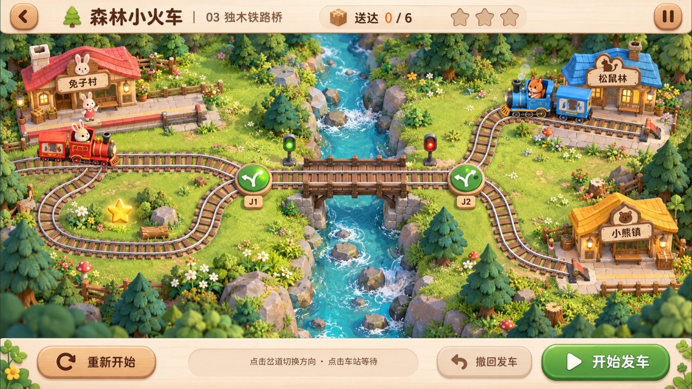
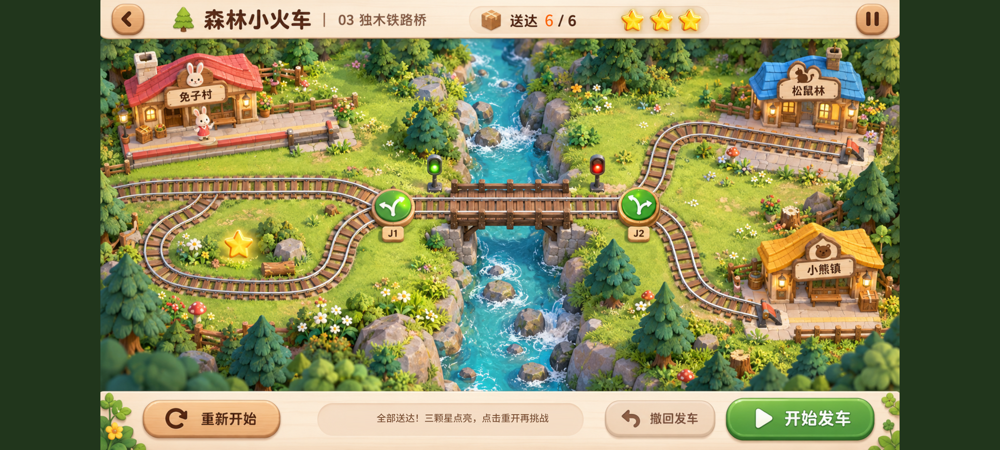

# 森林小火车实现与验证

日期：2026-10-29。用户明确确认[主画面设计稿](../designs/forest-train-v1/approved.png)后实现。

## 交付范围

游戏库新增“森林小火车”。提供确认稿中的独木铁路桥地图，三轮、六次正确送达。实现两列独立移动的列车、车站等待/放行、J1 环线/主线、J2 上下支线、岔道占用锁定、会车冲突与误送检查、暂停、整轮撤回、重开和返回游戏库。当前对局在本次应用运行内保留；不保存到磁盘。没有实现未经确认的其他地图，没有重新打包 APK。

## 设计稿对照

| 项目 | 核对结果 |
| --- | --- |
| 森林、河流、左侧环线、中央木桥、三座车站 | 直接使用确认稿原画，构图和相对位置保留；仅两辆原静态列车所在区域使用空轨道补片 |
| 顶部标题、关卡名、返回和暂停位置 | 保留确认稿图像和位置；暂停后同一按钮显示继续图标 |
| 底部三个按钮与说明栏 | 保留原图形、位置和中文标签；说明栏显示实际运行提示与目的地 |
| 列车 | 使用从确认稿派生的透明列车素材，独立沿轨道移动和换向；蓝车有蒸汽动画 |
| 进度与星星 | 新局 0/6，而确认稿是中途 2/6；每两次正确送达点亮一颗星，完成时 6/6 |
| 岔道状态 | 仅按钮内部切换方向，保留圆形轮廓；修正过早期采样带出方形轨道背景的问题 |
| 点亮星星 | 使用透明金星，修正过早期采样带出方形草地背景的问题 |
| 16:9 与 20:9 | 等比显示整幅画面，宽屏两侧留边；实际点击坐标使用同一等比换算 |

最终实际运行截图：





## 验证

- `cargo test --locked --offline forest_train -- --nocapture`：8 项通过。
- `cargo build --locked --offline --bin magnet-island`：通过。既有未使用代码警告仍存在。
- 实际 Bevy 窗口自动注入鼠标点击，使用真实输入处理和命中区域，不直接跳转游戏状态。
- 1280×720 与 1200×540 两种窗口尺寸均完成 17 项检查：切换岔道、冲突、撤回、车站等待、暂停、三轮接送、六次通关、重开、返回游戏库、从卡片重新进入。
- 16:9 首轮完整验证后修正两个透明图集问题；修正后的 20:9 完整流程再次通过，并重新采集最终 16:9 新局截图。
- 桌面验证不能代替安卓真机验证；本次没有构建或安装安卓 APK。

原始结果：[16:9](forest-train-qa-2026-10-29.json)、[20:9](forest-train-wide-qa-2026-10-29.json)。

## 试玩与复现

双击仓库根目录 `run-forest-train-mac.command`，或运行：

```sh
. ./scripts/env.sh
MAGNET_START_GAME=train cargo run --locked --offline --bin magnet-island
```

完整点击验证：

```sh
mkdir -p output/forest-train-qa
MAGNET_START_GAME=train MAGNET_PHONE_PREVIEW=1 MAGNET_QA=1 \
MAGNET_QA_SIZE=1280x720 MAGNET_SAVE_DIR=/private/tmp/forest-train-qa-save \
MAGNET_CAPTURE="$PWD/output/forest-train-qa/initial.png" \
./target/debug/magnet-island
```

宽屏使用 `MAGNET_QA_SIZE=1200x540` 和独立输出目录。测试使用 0.1 秒的确定性时钟加速跑完整轮；正常游戏使用真实时间。

美术由内置 imagegen 处理，最终资产路径和最终处理提示词见 [ART_NOTES.md](../assets/forest_train/ART_NOTES.md)。
